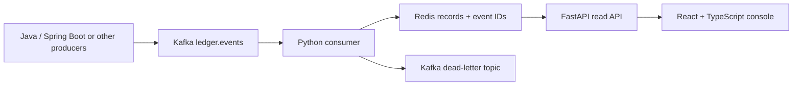

# Ledger Bridge

**An open-source, at-least-once Kafka event reconciler with atomic Redis state, a FastAPI query surface, and a React investigation console.**

Independent services often report the same transaction at different times. Ledger Bridge pairs an `expected` event with an `actual` event by correlation ID and reports `pending`, `matched`, or `mismatched` without comparing floating-point money values.

> Scope: one expected and one actual event per correlation ID. This is a reference service for internal workflows, not an accounting ledger or a payment authorization system.

## Architecture



The consumer validates each JSON event with Pydantic. A Redis WATCH transaction guards the read, reconciliation, and write. The record and event ID markers use seven-day expiration windows. The Kafka offset is committed only after Redis succeeds or an invalid/conflicting message is acknowledged by the dead-letter topic. A retry after a crash can see the marker and avoid a second state transition.

## Quick start

Prerequisites: Docker Compose v2. Run from the repository root:

```bash
docker compose up --build -d
```

Open `http://localhost:5173`. The API docs are at `http://localhost:8000/docs`.

Create the input and dead-letter topics and publish a pair of events:

```bash
docker compose exec kafka rpk topic create ledger.events ledger.events.dlq
echo '{"event_id":"expected-1001","correlation_id":"trade-1001","source":"expected","amount_minor":12500,"currency":"USD"}' | docker compose exec -T kafka rpk topic produce ledger.events
echo '{"event_id":"actual-1001","correlation_id":"trade-1001","source":"actual","amount_minor":12500,"currency":"USD"}' | docker compose exec -T kafka rpk topic produce ledger.events
curl http://localhost:8000/v1/reconciliations/trade-1001
```

The record will become `matched`; change the actual amount to see `mismatched` on a new correlation ID. Use `docker compose exec kafka rpk topic consume ledger.events.dlq` to inspect rejected events. Stop with `docker compose down`; add `-v` only if you intend to erase local Redis data.

## Event contract

| Field | Type | Rule |
| --- | --- | --- |
| `event_id` | string | Unique across all correlations during retention; 1–128 ASCII letters, digits, `_`, `.`, `:`, `-` |
| `correlation_id` | string | 1–128 ASCII letters, digits, `_`, `.`, `:`, `-` |
| `source` | string | `expected` or `actual` |
| `amount_minor` | integer | Strict JSON integer in minor currency units; negative and zero permitted |
| `currency` | string | Three uppercase ASCII letters |

The first event for a side wins. Replaying the same event ID with the same payload is a no-op. Reusing an event ID with a different payload, or using a new event ID to overwrite an occupied side, sends that event to the dead-letter topic. `matched` requires equal integer amounts and equal currency codes. Event order does not matter. Records expire seven days after the last accepted event; each event marker expires seven days after it was first accepted. After expiration, old events can be processed again; choose Kafka retention and upstream replay policy accordingly.

## API

`GET /v1/reconciliations/{correlation_id}` returns a record or `404`; invalid IDs return `422`. `GET /health/live` checks process liveness; `GET /health/ready` checks Redis. `GET /metrics` exposes Prometheus HTTP counters. The API is read-only. OpenAPI is served at `/openapi.json`.

## Development

```bash
python -m venv .venv
. .venv/bin/activate
pip install -r service/requirements-dev.txt
PYTHONPATH=service pytest -q service/tests
cd web && npm install && npm test && npm run build
```

The unit and API tests run without Docker via a fake Redis instance. The Python tests cover event order, duplicate payload integrity, mismatches, concurrent sides, OIDC token rejection, and API validation; Vitest checks console rendering and error reporting. GitHub Actions runs both suites, the TypeScript build, and a Compose smoke test that publishes Kafka events, polls the live API, checks dead-letter delivery, scrapes metrics, and restarts the worker before processing fresh events. To run that smoke test locally, start the stack and run `bash scripts/e2e.sh`.

## Deployment notes

Run the API and worker as separate containers. Provision Kafka topics, Redis persistence, network policy, TLS and credentials through your platform. This local Compose stack binds exposed ports to localhost. For an API deployment, set `APP_ENV=production`, `OIDC_ISSUER`, `OIDC_AUDIENCE`, and `OIDC_JWKS_URL` (all HTTPS URLs where applicable). The API refuses to start in production mode without these settings and requires a signed RS256 bearer token with matching issuer, audience, subject, issue time, and expiration for record lookups. Rotate keys at the identity provider; the JWKS cache refreshes on an unknown key. Keep `/metrics` and health endpoints internal through network policy. The bundled React console is a local developer tool; for an authenticated deployment, put it behind an OIDC-aware gateway that supplies the user's bearer token to the API, or integrate your organization's established frontend login flow. Never embed an API token in the frontend bundle. Keep the API private if event payloads include sensitive business identifiers. Set `REDIS_URL`, `KAFKA_BOOTSTRAP`, and optionally `KAFKA_TOPIC`, `LOG_LEVEL`, and `METRICS_PORT` on the worker. Kafka consumer group `ledger-bridge-v1` is fixed in this version. For AWS, a typical mapping is ECS for API/worker, MSK for Kafka, ElastiCache for Redis, and an authenticated private ingress. No AWS provisioning is included here.

**Operational limits:** Redis is the materialized source of reconciliation state; loss of Redis data requires replay from retained Kafka input. The read API does not provide historical revisions or pagination. A single event is one side of one correlation. Redis transactions and Kafka commits are not a distributed transaction: delivery is at least once, with idempotency bounded by the marker TTL. Monitor worker failures, Redis health, Kafka lag, and dead-letter volume. Worker metrics at port `9100` expose `ledger_events_total{outcome=...}`; the API exposes `ledger_http_requests_total{method,status}`. Neither uses correlation IDs as metric labels. The smoke test exercises local outcomes, dead-letter delivery, and a worker restart; it does not establish capacity, availability, or security for an internet-facing deployment.

## Contributing

Issues and small focused pull requests are welcome. Include a reproduction for bug fixes and tests for behavior changes. Run the Python and web commands above before submitting. Avoid real customer data in issues.

## License

MIT. See [LICENSE](LICENSE).
